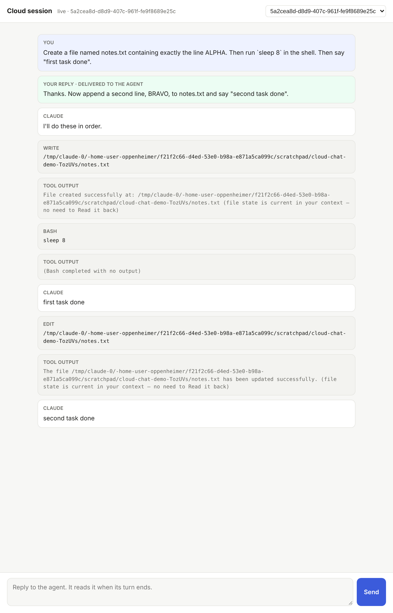
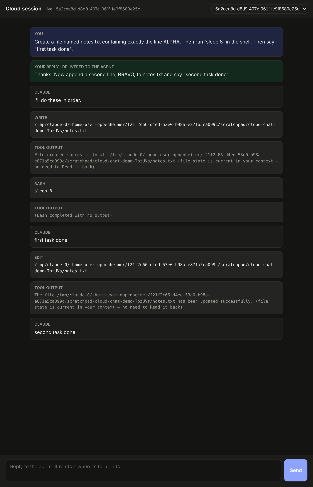

# cloud-chat-bridge — proof of concept

A Claude Code cloud session's chat in Oppenheimer, both ways: you see the
conversation live, and you can answer it.

This is a throwaway proof of concept. It is not wired into `apps/api`,
`apps/web` or `apps/runner`, and is not part of the pnpm workspace or CI.
`server.mjs` stands in for the API and the console.

## How a cloud session streams today

Read off a running cloud session (2026-11-06):

- The session is a VM. `environment-manager task-run --session cse_…` starts
  the `claude` CLI, which sends every event (each message, tool call and
  result) to `api.anthropic.com/v1/code/sessions/cse_…`, one event at a time.
  claude.ai reads that list. What you type there comes back down over SSE.
- That stream is Anthropic's, private, and on the account's own sign-in, so
  Oppenheimer cannot join it.
- The CLI also writes the same conversation to
  `~/.claude/projects/<dir>/<session>.jsonl`, the transcript the runner
  already reads for a host session's chat view. That file is what this
  proof of concept streams.

## What it shows

- **The chat streams out.** A `SessionStart` hook (`hooks/session-start.mjs`)
  starts a detached streamer. It follows the transcript Claude Code names on
  the hook's stdin (`transcript_path`), posts each complete line to
  `POST /api/sessions/{id}/transcript`, keeps its offset so a restart
  resends nothing, and never drops a line the server refused. In a cloud
  session the id is claude.ai's (`CLAUDE_CODE_REMOTE_SESSION_ID`, `cse_` read
  as `session_`), so it matches the cloud session Oppenheimer launched.
- **Your answer goes back in.** A `Stop` hook (`hooks/stop.mjs`) asks
  `GET /api/sessions/{id}/replies/next?wait=N` when the agent finishes a
  turn. A reply typed in the chat comes back as the hook's
  `{"decision":"block","reason": …}`, Claude Code's documented way for a hook
  to keep the agent going, and the agent carries on with it. With no reply
  in N seconds it lets the agent stop.
- **The page** (`index.html`) shows the transcript as chat items, live over
  server-sent events, and your replies where you sent them: "waiting for the
  turn to end", then "delivered to the agent".

Both hooks need `OPPENHEIMER_URL` and `OPPENHEIMER_CLOUD_KEY`, do nothing
without them, and never fail the session.

## Run it

```bash
node poc/cloud-chat-bridge/demo.mjs          # the whole loop, with checks
node poc/cloud-chat-bridge/demo.mjs --keep   # then leave the chat up
```

`demo.mjs` starts the server, makes a scratch project whose
`.claude/settings.json` carries both hooks, runs a real `claude -p` there
with a first task, sends a reply while the agent works, and checks the agent
did both. Run on 2026-11-06 inside a Claude Code cloud session, twice:

```
PASS  claude exited 0
PASS  transcript lines streamed        (43 lines)
PASS  first task done (ALPHA)
PASS  reply reached the agent (BRAVO)
```

| Light | Dark |
| --- | --- |
|  |  |

## What it does not answer yet

- **A real cloud session.** The demo ran a nested `claude -p` in a cloud VM,
  not a cloud session started from claude.ai with these hooks in its
  repository. The next check is a branch with the hooks in
  `.claude/settings.json` and a cloud environment that allows the API's host
  and holds the key.
- **An idle session.** The Stop hook can only answer at the end of a turn,
  and waits N seconds for a reply. Once the session is idle, only
  `claude -p "…" --cloud <id>` from a signed-in host wakes it.
- **How it reads on claude.ai.** A reply arrives there as hook feedback, not
  as a message from you, and claude.ai shows the session as working while
  the Stop hook waits.
- **The key.** A cloud environment's variables are plain text; the product
  needs a key scoped to posting transcripts and reading replies, nothing
  else.
