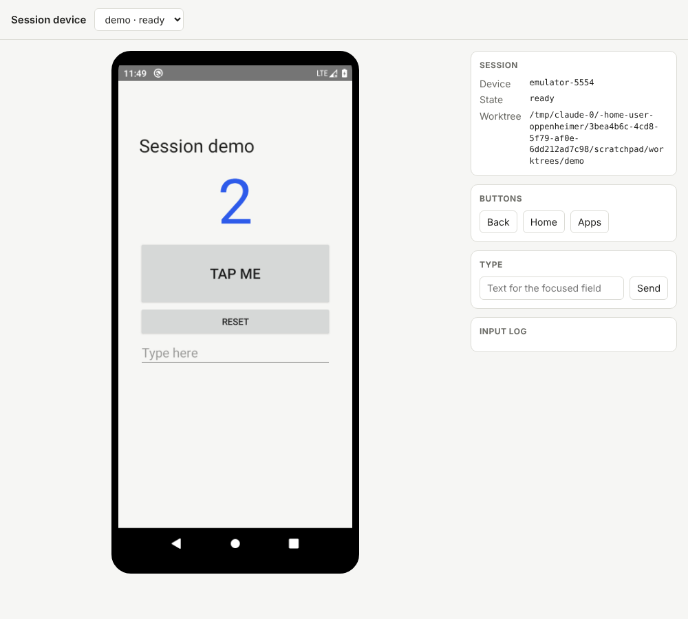
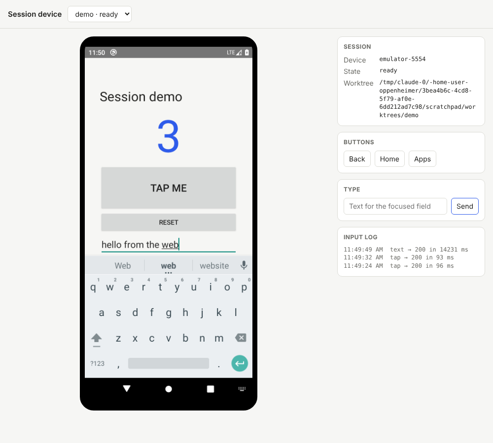

# device-stream — proof of concept

One device per session, streamed to the browser, driven by Argent.

This is a throwaway proof of concept for the piece of the runner that would
give each session its own Android emulator, tell the session's agent which
device is its own, and carry the device's screen and the reader's input to
the console. It is not wired into `apps/runner`, the API or `apps/web`, and is
not part of `go.work`, the pnpm workspace or CI.

## What it shows

- **One device per session.** `POST /api/sessions` either adopts a running
  emulator (`{"id": "demo", "serial": "emulator-5554"}`) or creates an AVD of
  its own, boots it on its own console port, and deletes both on
  `DELETE /api/sessions/{id}`. Two sessions cannot hold the same serial, and a
  host caps how many devices it runs (`-max-sessions`).
- **The agent is pinned to it.** The session's worktree gets a
  `CLAUDE.local.md` naming the serial (Argent picks the device the user names
  before any other) and a `session.env` with `ANDROID_SERIAL`, which plain
  `adb` honours.
- **The screen reaches the browser.** The host runs Argent's
  `simulator-server android --id <serial>` and relays its MJPEG stream at
  `GET /api/sessions/{id}/stream`. In the product this hop is the runner's
  link, then the WebRTC direct path.
- **The reader's input goes through Argent too.** `POST
  /api/sessions/{id}/input` (`tap`, `swipe`, `text`, `key`, `button`) calls the
  same Argent tool-server the agent's MCP server uses, with the session's
  serial filled in on the host. The browser names a session, never a device.

## Run it

Needs the Android SDK (`emulator`, `platform-tools`, `cmdline-tools`, a system
image), Node 22 and Argent:

```bash
sdkmanager "emulator" "platform-tools" "system-images;android-29;default;x86_64"
avdmanager create avd -n session-poc29 -k "system-images;android-29;default;x86_64" -d pixel_4
emulator -avd session-poc29 -no-window -no-audio -feature MultiDisplay -port 5554 &
npm i -g @swmansion/argent
argent server start --detach --port 3001        # prints a token
GOWORK=off go build -o device-stream .
./device-stream \
  -sdk "$ANDROID_HOME" \
  -argent-url http://127.0.0.1:3001 -argent-token <token> \
  -sim-server "$(npm root -g)/@swmansion/argent/bin/linux/simulator-server"
curl -X POST localhost:8790/api/sessions -d '{"id":"demo","serial":"emulator-5554"}'
open http://localhost:8790
```

On macOS use `bin/darwin/simulator-server`; the same server drives iOS
simulators with `ios --id <udid>`, which this POC does not wire up.

## What the run showed

Run on 2026-10-17 in a cloud container with 4 cores and no KVM, so the
emulator ran in software (`-accel off`):




- The agent (Argent's CLI, `--udid emulator-5554`) launched the demo app,
  read it with `describe` and tapped "TAP ME" twice; the reader then clicked
  the streamed screen in the browser and typed into the app's field. Both
  drove the same device, and the page showed each change.
- A tap from the page took 90–100 ms to answer, an agent tap about 300 ms;
  typing took 9–14 s, which is the software-emulated guest, not the path.
- A second session asking for `emulator-5554` got `409 device belongs to
  session demo`; input names a session, never a device.

What it took to get there, which the runner's device module has to handle:

- **`sys.boot_completed` is not ready.** On a slow host the watchdog
  restarts `system_server` after boot; wait for `service check input` too.
- **A sleeping screen sends no frames.** `svc power stayon true` and a
  wake-up key after boot.
- **Argent's `simulator-server` needs the emulator's MultiDisplay feature**
  (it fails with "The multi-display feature is not available" otherwise).
  The ATD image has it; the API 29 `default` image needs
  `-feature MultiDisplay`.
- **The ATD image never drew a pixel here.** It has no apps, and its screen
  stayed black with host-side SwiftShader composition. The API 29 `default`
  image draws. A host with a GPU or KVM may not have either problem.
- **The streamer keeps its stdin open**, since it reads commands there.
- **Argent's MJPEG stream sends a frame only when the screen changes**, and a
  frame is flushed whole only when the next one arrives; a still screen can
  leave the last frame half-delivered until something moves.
- **Without KVM the emulator is barely usable**: 5–7 minutes to boot, and
  System UI and the launcher raise "isn't responding" dialogs. A real host
  needs hardware acceleration (KVM on Linux, Hypervisor.framework on a Mac).

`demo-app/` is the one-screen app used for the run (a counter and a text
field), built by `demo-app/build.sh` with the SDK's tools and no Gradle.

## What it leaves out

- The relay and the direct path: the stream is a local HTTP proxy.
- Auth: the server listens on 127.0.0.1 and trusts whoever reaches it.
- A failed start tears down what it started (`teardown`), but a session
  removed while it is still booting races the boot that is under way.
- The agent pin is an instruction, not a fence: nothing stops an agent from
  passing another serial to Argent.
- A session that creates its own AVD (`POST /api/sessions` without
  `serial`) is written but was not run: a second software-emulated device
  did not fit in 4 cores.
- H.264: MJPEG is simple and heavy (several Mbps at full rate); the product
  wants a WebRTC video track.
- Argent's `simulator-server` is a separate binary from Software Mansion;
  check its terms before shipping anything that depends on it.
